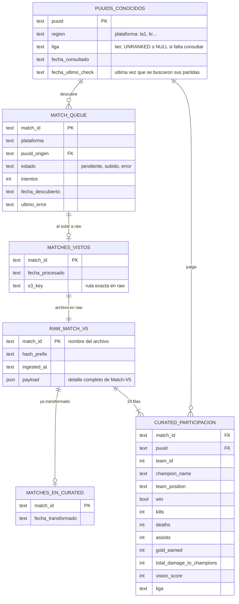
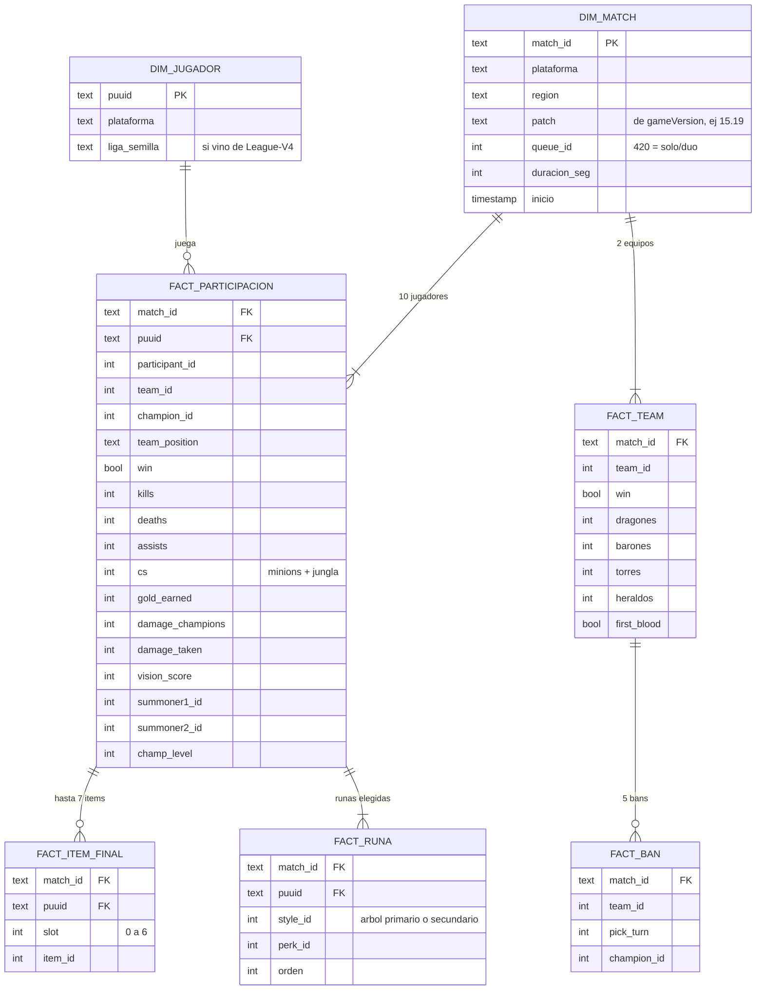
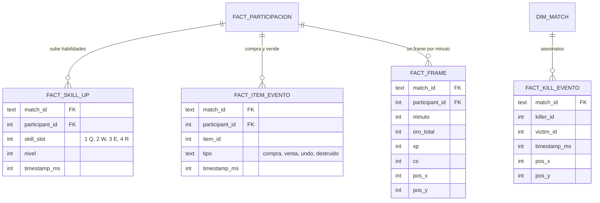
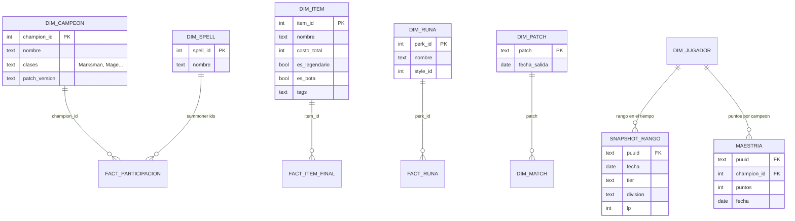

# Modelo de datos de RiftCat

Todo el proyecto visto como tablas y relaciones, separado en 5 niveles de
alcance. El nivel 1 es lo que corre hoy. Cada nivel se apoya en el
anterior y dice que cuesta construirlo.

Las relaciones son logicas: no hay llaves foraneas reales entre SQLite y
los parquet. El pegamento es `match_id` y `puuid`.

## Capas fisicas

| Capa | Hoy (local) | En AWS | Que guarda |
|---|---|---|---|
| Estado operativo | SQLite (`riftcat.db`) | DynamoDB | Que ya vimos, que falta, que ya se transformo, la cola |
| Raw | MinIO (`riftcat-raw`) | S3 | JSON crudo de Riot, inmutable, un archivo por partida |
| Curated | MinIO (`riftcat-curated`) | S3 + Glue | Parquet modelado para analisis |
| Marts | (pendiente) | S3 + Athena | Agregados listos para consultar |

Ruta de raw:
`match_v5/platform={PLATAFORMA}/dt={YYYY-MM-DD}/h={hash 2 digitos}/{match_id}.parquet`

---

## Nivel 1:

Estado: en cierre (ver checklist al final).



Flujo:

```
descubrir match_ids -> match_queue -> worker por region -> raw -> transform por lotes -> curated
```

Notas:
- SQLite es la fuente de verdad: `matches_vistos.s3_key` guarda la ruta
  exacta de cada archivo, asi el transform no lista raw.
  `python -m core.mantenimiento reconciliar` verifica que coincida con el
  bucket.
- `match_queue` evita perder match_ids si un proceso muere a medias (ver
  la nota del README sobre la cola persistente). Cada worker toma solo
  las plataformas de su region de ruteo.
- `liga` solo existe para los puuids sembrados desde League-V4 y para
  los que ya paso `actualizar_rangos_pendientes`. El resto queda en NULL.
  `UNRANKED` significa que se consulto y no tiene rango en solo/duo.
- Curated es hoy una sola tabla en un solo archivo que se reescribe en
  cada lote. Funciona a ~150K partidas; el nivel 2 lo particiona.

---

## Nivel 2: modelo dimensional (sale de raw actual)

Sin llamadas nuevas a la API. Todo esto ya esta dentro del JSON de raw;
solo falta extraerlo en el transform y reprocesar.



Que desbloquea:
- Builds finales, runas y hechizos con winrate por campeon.
- Banrate y objetivos por equipo.
- Todo filtrable por parche, que es lo que mas cambia el meta.
- Metricas por minuto (vision, CS, dano) gracias a `duracion_seg`, y
  filtrar remakes.

Como se guarda:
- Un parquet por tabla, particionado por `plataforma/patch`.
- El transform agrega archivos nuevos por particion en vez de reescribir
  uno gigante.
- `FACT_ITEM_FINAL` y `FACT_RUNA` son tablas puente: evitan columnas
  item0..item6 y hacen el GROUP BY trivial.
- Cada tabla nace con su esquema explicito (leccion del lote con todas
  las ligas en NULL).

---

## Nivel 3: timeline de partida (endpoint nuevo)

Requiere ingerir `/lol/match/v5/matches/{id}/timeline`: una llamada extra
por partida, asi que duplica el costo de rate limit de la descarga. Raw
nuevo: `riftcat-raw/match_timeline/`.



Que desbloquea:
- Orden de habilidades y orden real de compra (core build por tiempo).
- Diferencia de oro a los 10 y 15 minutos contra el rival de linea.
- Mapas de calor de muertes.
- Es la base del coach: casi todo lo util para entrenar a un jugador esta
  aqui.

---

## Nivel 4: catalogos estaticos y rango historico



Notas:
- Data Dragon es un JSON publico por parche: se descarga una vez por
  parche y no gasta rate limit. Convierte IDs como 3031 en nombres.
- `SNAPSHOT_RANGO` resuelve la liga NULL de los jugadores del snowball
  (League-V4 by-puuid, ruteo por plataforma, se puede paralelizar por
  servidor).
- `MAESTRIA` (champion-mastery-v4) es la senal real de OTP: alguien con
  800K puntos en un campeon es OTP aunque aparezca en 2 partidas.

---

## Nivel 5: marts

No son fuentes nuevas: son vistas materializadas encima de los niveles 2
a 4. Se recalculan al final de cada transform y son lo que consulta un
dashboard.

| Mart | Grano | Metricas | Necesita |
|---|---|---|---|
| `mart_campeon` | campeon x rol x parche x tier | winrate, pickrate, banrate, KDA, CS/min | N2 + N4 |
| `mart_item_campeon` | campeon x item x parche | veces comprado, winrate con item | N2 + DIM_ITEM |
| `mart_core_build` | campeon x primeros 3 legendarios | partidas, winrate | N3 para el orden real |
| `mart_matchup` | campeon A vs B, mismo rol | winrate, oro diff @15 | N2, N3 para oro diff |
| `mart_runas` | campeon x pagina de runas | winrate, pickrate | N2 + DIM_RUNA |
| `mart_skill_order` | campeon x orden de max | winrate | N3 |
| `mart_cobertura` | plataforma x parche | partidas, puuids, % con liga | N1 + N2 |

`mart_cobertura` es el tablero de salud del pipeline: cuantas partidas
hay por servidor y si alguno se esta quedando atras.

Las estadisticas globales se ponderan por servidor (post-estratificacion),
porque la muestra no es proporcional a la poblacion real.

---

## Orden de construccion

| Paso | Que | Por que en ese orden |
|---|---|---|
| 1 | Cerrar nivel 1 | La ingesta tiene que ser confiable antes de todo |
| 2 | Nivel 2 + Data Dragon | Sale gratis de raw, no gasta API; es el 80% del valor analitico |
| 3 | Marts basicos | Con N2 ya se arma un mini lolalytics para cualquier campeon |
| 4 | Snapshot de rango y maestria | Arregla la liga NULL y detecta OTPs |
| 5 | Timeline (N3) | El mas caro en API; vale la pena ya con ingesta paralela |

## Checklist de cierre del nivel 1

- [x] Transform incremental, por lotes, leyendo solo los archivos del lote
- [x] Transform marca solo lo procesado y usa esquema explicito
- [x] `riot_client`: timeout, reintentos para 429/5xx, errores tipados
- [x] Rangos pendientes ya no se atoran (UNRANKED, orden por antiguedad)
- [x] Tests de `riot_client` y de rangos
- [ ] Datos cerrados: sea terminado, transform final, curated = matches_vistos
- [x] `match_queue` en `core/db.py` con funciones y `busy_timeout`
- [x] `s3_key` en `matches_vistos`: el transform ya no lista raw
- [x] `core/mantenimiento.py`: rellenar-keys y reconciliar
- [ ] Poller en dos comandos: `descubrir` (encola) y `worker --region` (consume)
- [x] Tests de la cola, del estado y del transform
- [ ] README: que es, como correrlo, diagrama, tabla local <-> AWS
- [ ] Borrar `worker_region.py` de B
