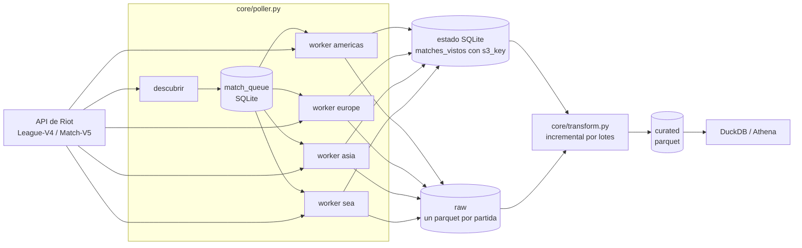

# RiftCat

Pipeline de datos de League of Legends: descarga partidas rankeadas de la
API de Riot, las guarda en un data lake (raw), las transforma a una tabla
analitica (curated) y permite consultarlas con SQL. Corre hoy en local
(MinIO + SQLite + DuckDB) con el mismo diseno que tendra en AWS
(S3 + DynamoDB + Athena), y es la base para una capa de ML de prediccion
de victoria con reentrenamiento por parche.

Proyecto personal de portafolio y de investigacion. Usa una Personal API
Key de Riot; los datos crudos no se redistribuyen.

## Estado

Version 0 local, nivel 1 del modelo de datos (octubre 2026):

| | |
|---|---|
| Partidas en raw | 147,783 (15 servidores, Platino a Challenger) |
| Partidas en curated | 147,770 (1.48M filas jugador-partida) |
| Consistencia SQLite vs raw | 100% (`python -m core.mantenimiento reconciliar`) |
| Tests | 46 con pytest |

Siguiente: migracion a AWS con Terraform (V1) y capa de ML (V2). Detalle
en [ESTADO_FASES.md](ESTADO_FASES.md) y en
[MODELO_DE_DATOS.md](MODELO_DE_DATOS.md).

## Arquitectura



- **Ingesta en dos pasos desacoplados por una cola.** `descubrir` busca
  las partidas recientes de los jugadores revisados hace mas tiempo y las
  encola; cada `worker` descarga lo pendiente de su region. Si un proceso
  muere, nada se pierde: la cola esta en disco.
- **Un worker por region de ruteo.** El rate limit de Match-V5 se cuenta
  por region (americas, europe, asia, sea), asi que 4 workers en paralelo
  no compiten entre si.
- **SQLite es la fuente de verdad.** Quien escribe en raw registra la key
  exacta; el transform sale de ahi y nunca lista el bucket.
- **Batch, no streaming.** Riot entrega ~0.8 partidas/s por region y los
  analisis (winrates por parche) no necesitan tiempo real. Un stream
  (Kafka/Kinesis) agregaria costo y piezas sin beneficio; la cola cumple
  el papel de desacoplar productor y consumidor.

## Como correrlo

Requisitos: Linux, Docker, conda, una API key de Riot.

```bash
# 1. Servidor: Docker, Miniconda y plantilla de ~/riftcat-env.sh
bash bash_script/config/setup_server.sh
nano ~/riftcat-env.sh            # RIOT_API_KEY y credenciales de MinIO

# 2. MinIO local con los buckets riftcat-raw y riftcat-curated
bash bash_script/config/levantar_minio.sh

# 3. Entorno de Python
bash bash_script/config/crear_entorno_python.sh
conda activate riftcat
source ~/riftcat-env.sh
```

Uso:

```bash
python -m core.poller muestrear                # sembrar jugadores desde League-V4
python -m core.poller ciclo                    # descubrir + workers por region + rangos
python -m core.poller worker --region sea      # solo una region
python -m core.transform                       # raw -> curated (solo lo nuevo)
python -m core.query                           # top 20 campeones con winrate
python -m core.mantenimiento reconciliar       # SQLite vs raw
python -m pytest tests/                        # tests
```

`run_poller.sh` corre un ciclo y sirve para cron. Codigos de salida del
poller: 0 ok, 1 key invalida, 2 Riot caido (lo pendiente queda en cola).

## Local vs AWS

| Pieza | Local (hoy) | AWS (V1) |
|---|---|---|
| Data lake raw y curated | MinIO | S3 |
| Estado (cola, vistos, transformados) | SQLite | DynamoDB |
| Cola de descarga | tabla `match_queue` | SQS |
| Disparo de la ingesta | cron + `run_poller.sh` | EventBridge + Lambda |
| Deteccion de archivos nuevos | `matches_vistos.s3_key` | S3 Event Notifications a SQS |
| Formato de curated | un parquet | Iceberg (Glue Data Catalog) |
| Consultas | DuckDB | Athena |
| Infraestructura | scripts bash | Terraform |

El codigo usa boto3 con `AWS_ENDPOINT_URL_S3`: para pasar de MinIO a S3
basta quitar esa variable y usar credenciales de AWS.

## Estructura

```
core/
  riot_client.py    cliente de la API: timeout, reintentos, errores tipados
  poller.py         ingesta (CLI): muestrear, descubrir, worker, rangos, ciclo
  db.py             estado en SQLite: cola, vistos, transformados, puuids
  parquet_writer.py escritura a raw con particion platform/dt/hash
  transform.py      raw -> curated, incremental por lotes
  mantenimiento.py  rellenar-keys y reconciliar
  query.py          consulta de ejemplo
tests/              pytest
bash_script/        setup del servidor, ciclo de ingesta, reset
```

## Registro de decisiones

Notas escritas conforme se tomaron las decisiones, con el problema real
que las motivo.

**NOTA: por que el particionado por hash, aunque se vea "vacio" ahorita**
Con pocas partidas, el hash de 2 digitos (256 combinaciones posibles)
genera casi una carpeta por archivo, lo cual se ve raro navegando MinIO
a mano. Es esperado: el proposito del hash no es verse ordenado a bajo
volumen, es evitar cuellos de botella de escritura en S3 cuando el
volumen crezca a cientos de miles de archivos. El costo de tenerlo desde
el inicio es minimo (unas 4 lineas de codigo), mientras que agregarlo
despues, con datos ya escritos sin particionar, seria mucho mas caro.
Las queries (DuckDB/Athena) leen con un patron glob que ignora cuantas
subcarpetas haya, asi que no afecta el performance de lectura, solo la
navegacion visual manual.


**NOTA: por que el rango es un snapshot, no un valor que se actualiza solo**
La API de Riot no expone historial de rango por fecha, solo el rango
actual al momento de preguntar. Un jugador capturado como CHALLENGER
puede bajar de rango dias despues sin que la tabla se entere (caso real
confirmado: un jugador de la muestra inicial ya aparecia como
Grandmaster en su perfil web pocos dias despues de capturarlo como
Challenger). Se acepta como aproximacion razonable para el objetivo de
"mejores campeones por liga", ya que el rango de alto nivel no cambia
drasticamente en pocos dias. Pendiente: mecanismo de refresco periodico
(la columna fecha_consultado ya existe para eso, aunque hoy no se usa
para refrescar, solo para saber cuando se consulto por primera vez).

**NOTA: por que el snowball sampling es gradual, no recursivo en la misma corrida**
Procesar de inmediato las partidas de cada jugador recien descubierto
puede crecer sin control (10 jugadores nuevos por partida, cada uno
trayendo mas partidas con mas jugadores). En vez de eso, cada partida
procesada solo guarda los puuids de sus 10 participantes sin rango
todavia (liga NULL); sus partidas se recogen en una corrida futura del
poller. Una tarea aparte, al final de cada corrida, actualiza hasta N
rangos pendientes por vez. Esto vuelve el crecimiento del dataset
predecible y apto para correr sin supervision via cron.

**NOTA: por que la consulta de rangos vive en el poller y no en db.py**
db.py solo habla con SQLite (una responsabilidad). La funcion que
actualiza rangos pendientes necesita hacer una llamada HTTP a la API de
Riot ademas de tocar la base de datos, asi que se dejo en poller.py
(el orquestador), manteniendo la separacion que ya seguia el resto del
proyecto: db.py = solo SQLite, riot_client.py = solo HTTP, poller.py =
junta ambos.


**NOTA: el rate limit es por routing value (y hay dos tipos)**
El limite (20 req/s, 100 req/2min) se cuenta por routing value, no por
app. Primero se confirmo con el header x-app-rate-limit-count (21-09-26:
llamar a LA1, NA1 y LA1 otra vez; el contador de LA1 solo vio sus 2
llamadas). Despues (29-09-26) se vio que hay dos tipos de ruteo:
- League-V4 y Summoner-V4 usan ruteo por PLATAFORMA (la1, kr, euw1...):
  15 contadores independientes.
- Match-V5 usa ruteo REGIONAL (americas, europe, asia, sea): solo 4
  contadores. tr1, ru y me1 comparten el de europe, por ejemplo.
Por eso, para descargar partidas, el maximo paralelismo util es un
worker por region (4), no uno por servidor. Mas workers en la misma
region solo se reparten la misma cuota y chocan con el 429.
Resultado (29-09-26): la fase de subida de ~55K partidas paso de ~26h
en serie a ~13h con 3 workers (americas, europe, sea). No depende de
los nucleos del servidor: los workers pasan casi todo el tiempo
esperando a Riot (~3% de CPU cada uno).
Los method rate limits del portal (ej. 2000 req/10s en Match-V5) son
un tope por endpoint; el limite real es el menor entre ese y el de la
app.


**NOTA: cola persistente de match_ids (match_queue)**
Incidente (28-09-26): un script de dos fases guardaba los match_ids
descubiertos en un set de Python. La dev key expiro a media fase 2 y
~62K match_ids quedaron en riesgo: los puuids que los originaron ya
estaban marcados como revisados, asi que relanzar no los volvia a
buscar. Se recuperaron redescubriendo los puuids por su
fecha_ultimo_check del dia de la corrida.
Solucion: tabla match_queue en SQLite (match_id, plataforma,
puuid_origen, estado, intentos, ultimo_error). La fase 1 escribe ahi en
vez de memoria; la fase 2 lee WHERE estado = 'pendiente'. Si el proceso
muere, se relanza el mismo comando y sigue donde iba. Tambien es la base
de los workers por region. Los scripts se detienen solos ante un
401/403 en vez de seguir quemando la lista.


**NOTA: transform leia todo raw en cada lote**
El transform ya era incremental en QUE procesar (matches_en_curated),
pero no en QUE LEER: para sacar los 1000 payloads de un lote, la query
hacia read_parquet sobre todo raw y filtraba con un JOIN. DuckDB tenia
que abrir los ~127K archivos por HTTP en cada lote. Con 91K archivos y
MinIO sin carga se notaba poco; con 127K y workers escribiendo, el
primer lote llevaba 40 min sin terminar de leer.
Fix (29-09-26): el listado inicial ya trae la ruta completa de cada
archivo; se guarda en un dict match_id -> ruta y cada lote hace
read_parquet([rutas del lote]). Lectura de 1000 payloads: 3.2s. Lote
completo: ~10s. 42 lotes: ~8 min en vez de mas de un dia (~200x).


**NOTA: marcar como transformado solo lo que si se leyo**
Bug: procesar_lote marcaba en matches_en_curated todos los match_ids
del lote aunque su payload no se hubiera leido. Si un archivo fallaba,
la partida quedaba marcada y nunca se reintentaba (10 partidas perdidas
en la primera corrida: 79022 marcadas vs 79012 en curated).
Fix: solo se marcan los match_ids que produjeron filas; los faltantes
se reportan en el log y se reintentan en la siguiente corrida.


**NOTA: SET threads=1 en DuckDB**
IOException ("Failure when receiving data from the peer") al leer raw
desde MinIO. No era un archivo corrupto (boto3 descargaba el mismo
archivo sin problema). Causa: DuckDB abre muchas conexiones HTTP en
paralelo y MinIO en un servidor con pocos recursos las cortaba. Con
threads=1 la lectura es estable. Revisar este valor al migrar a S3 real,
donde el paralelismo si deberia ayudar.


**NOTA: servidores estancados en el snowball**
Riot no hace matchmaking entre regiones, asi que el snowball solo crece
dentro del servidor donde se sembro. Ademas, la cola de revision
(ORDER BY fecha_ultimo_check IS NOT NULL, fecha_ultimo_check) deja los
NULL empatados en orden de rowid, o sea, orden de insercion. Resultado:
9 servidores (na1, tr1, ru, vn2, tw2, sg2, oc1, me1, la2) llevaban dias
con ~1-2K partidas contra ~16K de los primeros sembrados, y a ese ritmo
hubieran tardado cientos de horas en avanzar.
Solucion: corrida dirigida a los puuids pendientes de esos 9 servidores.
Resultado: ~8K partidas cada uno. Pendiente: la1 sigue en ~1.5K.


**NOTA: balancear la ingesta vs ponderar en el analisis**
Aun despues de la corrida dirigida, 5 servidores (euw1, kr, eun1, br1,
jp1) tienen ~la mitad del dataset, y la muestra no es proporcional a la
poblacion real (jp1 pesa casi como kr). En vez de perseguir un balance
perfecto en la ingesta, las estadisticas globales se ponderan por
servidor (post-estratificacion): peso igual si cada region debe contar
lo mismo, peso por poblacion si se quiere representar al jugador
promedio. Las corridas dirigidas se usan solo para que ningun servidor
quede con muy poca muestra.


**NOTA: liga conocida solo para jugadores sembrados**
Solo los puuids sembrados desde League-V4 tienen liga; los descubiertos
por snowball quedan en NULL (la mayoria de curated). Los analisis por
liga usan solo esa submuestra, y cada jugador sembrado aparece ~5 veces,
asi que las partidas no son independientes: los intervalos de confianza
calculados por partida son optimistas. Pendiente: snapshot de rango
para los participantes (League-V4 by-puuid) y champion-mastery-v4 para
detectar OTPs de verdad.
Detalle: el log "Rangos cargados: N puuids con liga conocida" cuenta
todos los puuids, incluidos los NULL. Corregir el mensaje.


**NOTA: Personal API Key**
La dev key expira cada 24h y fue la causa de varios cortes. Desde el
28-09-26 se usa una Personal API Key (aprobada al registrar el producto
en el portal): mismos limites, sin expiracion. No se deben usar varias
keys a la vez para rebasar los limites (va contra las politicas de Riot).
La key vive solo en riftcat-env.sh, nunca en el repo.


**NOTA: SQLite es la fuente de verdad, raw no se lista**
Hasta el 15-10-26 el transform listaba todo raw en cada corrida para saber
que habia de nuevo: con 147K archivos tardaba ~6 min, porque DuckDB abria
cada archivo para leer su metadata. Ahora quien escribe registra lo que
escribio: subir_a_raw devuelve la key exacta y marcar_visto la guarda en
matches_vistos.s3_key. El transform sale de SQLite (matches_vistos menos
matches_en_curated) con rutas exactas, sin listar nada, asi que cada
corrida cuesta lo mismo con 150K archivos que con millones.
Para confirmar que SQLite y el bucket siguen coincidiendo existe
python -m core.mantenimiento reconciliar (usa ListObjects de S3: paginas
de 1000 nombres, sin abrir archivos). Las partidas viejas sin key se
llenaron una vez con python -m core.mantenimiento rellenar-keys.
En AWS el equivalente es S3 Event Notifications hacia SQS, y para curated
un formato de tabla (Iceberg) que lleve su propio registro de archivos.


**NOTA: partidas sin participantes**
13 partidas en raw llegaron de Riot con info.participants vacio. No
aportan filas a curated; el transform las marca como transformadas y las
reporta en el log para que no se reintenten en cada corrida.
